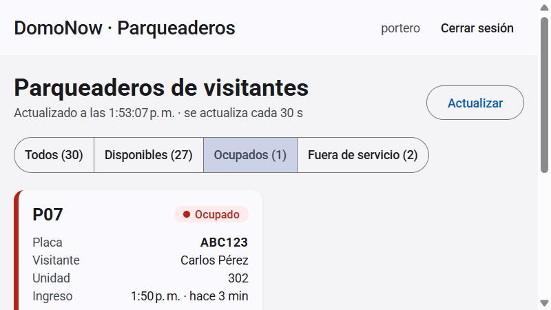
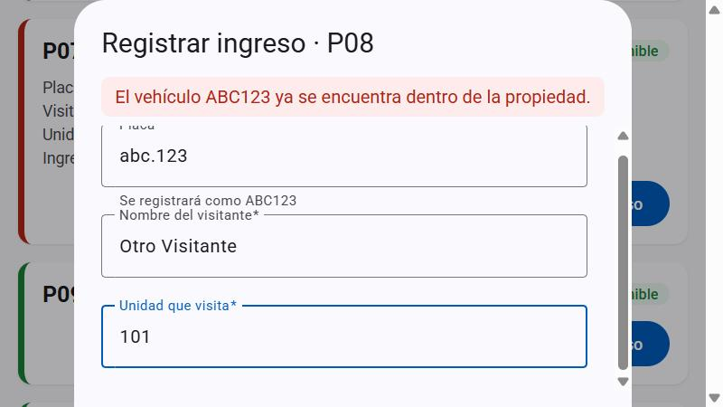

# DomoNow — Control de parqueaderos de visitantes

Solución Full Stack para la prueba técnica de OFIMA SAS: registrar el ingreso y la salida de vehículos de visitantes en los parqueaderos de una propiedad horizontal, garantizando que un parqueadero nunca tenga dos asignaciones activas.

| Capa | Tecnología |
|------|-----------|
| Backend | .NET 10 · ASP.NET Core (Minimal APIs) · EF Core · PostgreSQL 17 |
| Frontend | Angular 22 (zoneless) · TypeScript 6 strict · Signals · Signal Forms · Angular Material 22 · RxJS |
| Seguridad | JWT Bearer · PasswordHasher (PBKDF2) · user-secrets |
| Pruebas | xUnit · Shouldly · WebApplicationFactory + PostgreSQL real |

> 🚧 En construcción. Estado detallado en [`docs/PROGRESS.md`](docs/PROGRESS.md).

## Requisitos previos

- .NET SDK 10.0.401+
- Node.js 24 LTS (recomendado vía nvm) y Angular CLI 22
- PostgreSQL 17

## Configurar la base de datos

1. Tener PostgreSQL 17 corriendo en `localhost:5432`.
2. Configurar los secretos de desarrollo con `dotnet user-secrets` (no se versionan). La forma más simple es el script, que pide las contraseñas, genera una clave JWT aleatoria y configura también la base de las pruebas:

   ```bash
   powershell -ExecutionPolicy Bypass -File scripts/setup-dev-secrets.ps1
   ```

   O manualmente:

   ```bash
   cd backend
   dotnet user-secrets set "ConnectionStrings:Parking" "Host=localhost;Port=5432;Database=domonow_parking;Username=postgres;Password=<tu-password>" --project src/DomoNow.Parking.Api
   dotnet user-secrets set "Jwt:SigningKey" "<clave aleatoria de 32+ bytes>" --project src/DomoNow.Parking.Api
   dotnet user-secrets set "SeedOperator:Username" "portero" --project src/DomoNow.Parking.Api
   dotnet user-secrets set "SeedOperator:Password" "<password del operador de prueba>" --project src/DomoNow.Parking.Api
   ```

   Una clave aleatoria se puede generar con `openssl rand -base64 48`.
3. Al arrancar en Development la API aplica las migraciones y siembra 30 parqueaderos (`P04` y `P17` fuera de servicio) y el operador de prueba. No hace falta crear la base de datos a mano.

> Los user-secrets solo se cargan con `ASPNETCORE_ENVIRONMENT=Development`. Ejecute con el perfil `http` o `https` (`dotnet run --launch-profile http`, o el selector de perfil de Visual Studio); ejecutar el `.exe` directamente arranca en Production y la API indicará que falta `ConnectionStrings:Parking`.

## Ejecutar el backend

```bash
dotnet run --project backend/src/DomoNow.Parking.Api --launch-profile http
```

- API en `http://localhost:5080`; documento OpenAPI en `http://localhost:5080/openapi/v1.json`.
- Obtener un token: `POST /api/auth/login` con `{ "username": "portero", "password": "<password>" }` y enviarlo como `Authorization: Bearer <token>`.

| Método | Ruta | Autorización | Descripción |
|--------|------|--------------|-------------|
| POST | `/api/auth/login` | Anónimo (máx. 10/min por IP) | Inicia sesión y devuelve un JWT |
| GET | `/api/parking-spots?status=Available` | Autenticado | Parqueaderos con estado, disponibilidad y vehículo actual; filtro opcional por estado |
| GET | `/api/parking-assignments/active` | Autenticado | Vehículos que están dentro de la propiedad |
| POST | `/api/parking-assignments` | Rol `Operator` | Registra un ingreso `{ parkingSpotId, licensePlate, visitorName, destinationUnit }` |
| PUT | `/api/parking-assignments/{id}/checkout` | Rol `Operator` | Registra la salida; cuerpo opcional `{ checkedOutAt }` |

Los errores siguen RFC 9457 (ProblemDetails) con un campo `code` estable (`Parking.SpotOccupied`, `Parking.VehicleAlreadyInside`…) y un mensaje en español: 400 validación · 401 sin sesión · 403 sin rol · 404 no encontrado · 409 conflicto · 422 regla de negocio.

## Ejecutar el frontend

Requiere la API corriendo en `http://localhost:5080` (su CORS ya permite `http://localhost:4200`).

```bash
cd frontend
npm install
npm start
```

Abrir `http://localhost:4200` e ingresar con el operador de prueba configurado en `SeedOperator` (usuario `portero`). En PowerShell con la política de ejecución por defecto, usar `npm.cmd` en lugar de `npm`.

| Comando | Qué hace |
|---------|----------|
| `npm start` | Servidor de desarrollo en `http://localhost:4200` |
| `npm test` | Pruebas unitarias y de componentes (Vitest + jsdom) |
| `npm run lint` | angular-eslint |
| `npm run build` | Build de producción en `frontend/dist/` |

**Qué hace la pantalla:** tarjetas por parqueadero con color por estado (verde disponible, rojo ocupado con placa, visitante, unidad y tiempo transcurrido, gris fuera de servicio), filtro por estado con contadores, registro de ingreso con vista previa de la placa normalizada, salida con confirmación y la tabla de vehículos dentro. Se actualiza sola después de cada acción y cada 30 s (se pausa si la pestaña no está visible). Capturas reales en [`docs/screenshots/`](docs/screenshots/).

| Tablero (filtro "Ocupados") | Placa ya dentro (error del backend) |
|---|---|
|  |  |

## Ejecutar las pruebas

```bash
dotnet user-secrets set "ConnectionStrings:ParkingTests" "Host=localhost;Port=5432;Database=domonow_parking_tests;Username=postgres;Password=<tu-password>" --project backend/tests/DomoNow.Parking.Api.IntegrationTests
dotnet test backend/DomoNow.Parking.slnx
```

| Proyecto | Qué prueba | Tests |
|----------|-----------|-------|
| `Domain.UnitTests` | Value objects y agregado `ParkingSpot`: reglas R1–R5 sin base de datos | 43 |
| `Application.UnitTests` | Casos de uso con puertos falsos: R7, errores de validación, login | 14 |
| `Api.IntegrationTests` | API completa contra PostgreSQL real: autenticación (401/403, token vencido o con otra firma, rate limit por IP), flujos, errores y **concurrencia** (20 ingresos simultáneos al mismo parqueadero → exactamente 1 éxito; misma placa en 2 parqueaderos a la vez → 1 éxito; 10 salidas simultáneas → 1 éxito) | 25 |

Las pruebas de integración recrean la base `domonow_parking_tests` en cada corrida. No se usan SQLite ni InMemory porque no reproducen `xmin`, los índices parciales ni la concurrencia real.

Frontend (`cd frontend && npm test`): **58 pruebas** (Vitest).

| Área | Qué prueba |
|------|-----------|
| `core/http` | Traducción de ProblemDetails a mensajes en español (sin conexión, 401, 429, genérico) |
| `core/auth` | Sesión en signals + `sessionStorage`, interceptor JWT solo hacia la API, 401 → login con aviso, página de login (Signal Forms) |
| `features/parking` | Reglas de placa, mapeo DTO → dominio, adaptador HTTP, **store reactivo** (contadores, filtro, polling cada 30 s pausado con la pestaña oculta, timeout de 10 s si la API se cuelga, último tablero conservado si la API falla, una sola acción por parqueadero), tarjeta, diálogo de ingreso, página del tablero (cierra diálogos al salir, sin estados vacíos engañosos) |

## Decisiones de arquitectura

Resumen en [`docs/ARCHITECTURE.md`](docs/ARCHITECTURE.md); decisiones formales en [`docs/adr/`](docs/adr/).

- **Domain-Driven Design**: `ParkingSpot` como Aggregate Root, lenguaje ubicuo en [`docs/DOMAIN.md`](docs/DOMAIN.md) (ADR-0003).
- **Clean Architecture + Hexagonal**, versión pragmática (ADR-0001).
- **Concurrencia** garantizada en la base de datos con índice único parcial + concurrencia optimista (ADR-0002).
- **Autenticación JWT** con operadores y roles; la identidad es un subdominio genérico fuera del dominio `Parking` (ADR-0004).
- **Regla adicional R7**: una placa no puede ingresar dos veces sin haber salido; como cruza agregados, se protege en el caso de uso y con un índice único parcial por placa (ADR-0005).

## Supuestos

- Una sola propiedad con 30 parqueaderos de visitantes (`P01`–`P30`), sembrados al crear la base de datos.
- Placas colombianas: carro `ABC123`, moto `ABC12D`. Se normalizan quitando espacios, guiones y puntos y pasando a mayúsculas. Placas extranjeras o diplomáticas no se aceptan en esta versión.
- La hora de salida la pone el servidor; opcionalmente el cliente puede indicar una hora pasada (registro tardío), que nunca puede ser anterior al ingreso ni futura.
- Las fechas se almacenan en UTC; el frontend las muestra en la zona horaria del navegador.
- Solo los operadores autenticados con rol `Operator` registran ingresos y salidas. Un operador de prueba se crea en Development con credenciales tomadas de `dotnet user-secrets`.
- El estado "Cancelada" existe en el modelo, pero no se expone endpoint de cancelación.
- `DestinationUnit` es texto libre (no se valida contra un maestro de unidades, que pertenece a otro contexto de DomoNow).

## Qué mejoraría con más tiempo

Backend (hallazgos menores de la revisión con IA, conscientemente diferidos):

- Leer parqueaderos y asignaciones activas en **una sola consulta** (hoy son dos; un ingreso entre ambas puede mostrar por un instante un parqueadero ocupado sin placa).
- Validar explícitamente el filtro `?status=` (hoy `?status=7` devuelve lista vacía) y exigir `parkingSpotId` en el cuerpo (hoy su ausencia da 404 en lugar de 400).
- HTTPS/HSTS fuera de Development, o documentar la terminación TLS en el proxy; detrás de un proxy, `ForwardedHeaders` para que el rate limit por IP vea la IP real.
- Refresh tokens y revocación; endpoint de cancelación de asignaciones; volver a poner en servicio un parqueadero.

Frontend (hallazgos menores de la revisión con IA, conscientemente diferidos):

- `disableClose` en los diálogos para que un doble clic en la tarjeta no cierre el diálogo recién abierto.
- Aplicar localmente el resultado de un ingreso/salida en vez de esperar la recarga (hoy la tarjeta muestra el estado anterior durante una petición).
- Indicador visual en "Actualizar"/"Reintentar" mientras se recarga.
- Validar nombre y unidad sobre el texto recortado (hoy "   " pasa en el cliente y el backend responde 400, que sí se muestra).
- Comparar el origen completo de la URL en el interceptor JWT en lugar de `startsWith`.

## Evolución de la solución

> ¿Qué cambiaría si DomoNow manejara 5.000 propiedades y cientos de miles de movimientos diarios?

_Pendiente._

## Uso de IA

Ver [`AI-USAGE.md`](AI-USAGE.md).
